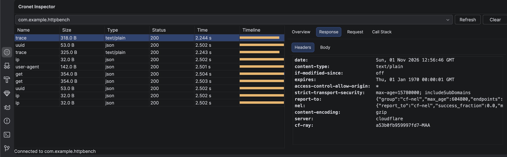

# Cronet Request Inspector

Network visibility for [Cronet](https://developer.android.com/develop/connectivity/cronet)-based
Android apps, inside Android Studio, with zero app code changes.

Android Studio's built-in Network Inspector only understands OkHttp,
`HttpURLConnection`, and gRPC. Apps built on Cronet (`org.chromium.net`) — whether
via the embedded artifact, `play-services-cronet`, or an OkHttp-bridge library like
`cronet-okhttp` — get no network visibility from Studio at all. This project closes
that gap with two pieces working together:

- a **Gradle plugin** that auto-instruments your app's Cronet traffic at compile
  time (debug builds only), and
- an **Android Studio tool window** that mirrors the built-in Network Inspector's
  own UI — a Connection View table plus an Overview / Response / Request / Call
  Stack detail pane — so if you already know how to use Studio's Network Inspector,
  you already know how to use this.



## Table of contents

- [Quick start](#quick-start)
- [Using the tool window](#using-the-tool-window)
- [How it works](#how-it-works)
- [Known limitations](#known-limitations)
- [Building from source](#building-from-source)
- [License](#license)

## Quick start

### 1. Add the Gradle plugin to your app module

```kotlin
// app/build.gradle.kts
plugins {
    id("com.jitinsharma.cronetinspector.gradle") version "0.1.3"
}
```

That's the only app-facing change. On apply, the plugin checks whether your app
actually depends on Cronet (directly or transitively, e.g. through
`play-services-cronet` or a bridge library) and, only if so:

- adds the `runtime` dependency to your `debug` variant automatically — no extra
  line needed, and
- instruments your debug build's bytecode to capture request/response/body/timing
  data with no changes to your own source.

If your app doesn't depend on Cronet, applying the plugin is a harmless no-op.

### 2. Install the IDE plugin

Available on the [JetBrains Marketplace](https://plugins.jetbrains.com/plugin/34379-cronet-network-inspector/).
In Android Studio: **Settings → Plugins → Marketplace**, search "Cronet Network
Inspector", install, and restart.

Alternatively, build it from source and install it from disk:

```
git clone https://github.com/jitinsharma/cronet_request_inspector.git
cd cronet_request_inspector
./gradlew :idea-plugin:buildPlugin
```

This produces `idea-plugin/build/distributions/idea-plugin.zip`. In Android
Studio: **Settings → Plugins → ⚙️ → Install Plugin from Disk...**, pick that zip,
and restart.

### 3. Capture traffic

1. Run your (instrumented, debug-build) app on a connected device or emulator.
2. In Android Studio, open the **Cronet Inspector** tool window (bottom toolbar, or
   **View → Tool Windows → Cronet Inspector**).
3. Pick your app from the process dropdown at the top — it lists every
   currently-debuggable process on the connected device.
4. Use your app normally. Requests appear in the Connection View table as they
   happen; click one to see headers, bodies, timing, and call stack in the detail
   pane below.

## Using the tool window

- **Connection View table** — one row per request: name, size, type, status,
  elapsed time, and a two-tone timeline bar (orange = waiting for a response, blue =
  receiving one).
- **Overview tab** — method, status, response type, negotiated protocol (e.g.
  `h2`), initiating thread, a clickable URL, and a timing bar for that one request.
- **Response / Request tabs** — headers and body, each in their own sub-tab, with
  bold header names in a monospace layout.
- **Call Stack tab** — the full Java/Kotlin call stack captured at the instant the
  request was built, one frame per line (`methodName:line, ClassName
  (package.name)`), so you can trace a request back to the exact line in your app
  that issued it.
- **Clear** — empties the visible table. Capture itself keeps running in the
  background; this only resets what's displayed.
- Switching the app-picker dropdown to a different process clears the table and
  starts a fresh capture session for that process.

## How it works

| Module | Role |
|---|---|
| `gradle-plugin` | Applied in your app module. Uses AGP's public Instrumentation API (ASM bytecode weaving, debug builds only) to rewrite your app's own `UrlRequest.Callback`/`UploadDataProvider` subclasses — and any Cronet-adjacent bridge library's, like `cronet-okhttp`'s — plus a handful of narrow Cronet `Builder` call sites, teeing request/response/body/call-stack data into the runtime. No source changes in your app. |
| `runtime` | The in-app library the plugin wires in automatically. Buffers captured events and streams them over a local socket as length-prefixed protobuf frames. |
| `proto` | The wire schema shared between the in-app runtime and the IDE plugin. |
| `idea-plugin` | The standalone Android Studio tool window. Connects to a running device via `adb forward`, lets you pick any debuggable process, and renders the Connection View + detail pane. |
| `sample-app` | A minimal Cronet client used as the end-to-end test fixture for all of the above. |

## Known limitations

- **Debug builds only**, by design — matches how the built-in Network Inspector
  only works on debuggable/profileable processes.
- **Third-party bridge quirk**: at least one Cronet-OkHttp bridge library can
  report a request as canceled here even though the app itself received a normal
  successful response — a quirk in that library's own internal callback sequencing,
  not this tool's instrumentation.
- Instrumentation can't reach `play-services-cronet`'s actual native implementation
  classes, since those are loaded dynamically at runtime rather than compiled into
  your app — this doesn't affect capture, since your app's own callback/builder
  code (which is what's actually instrumented) behaves identically regardless of
  which Cronet backend is running underneath.

## Building from source

Requires JDK 21 (used for the whole build; individual modules target 17 or 21
explicitly — see each `build.gradle.kts` for why).

```
./gradlew build
```

To iterate on the Gradle plugin against your own Cronet-using app without
publishing anything, point your project's `settings.gradle.kts` at this repo's
`gradle-plugin` via `includeBuild(...)`, and apply
`id("com.jitinsharma.cronetinspector.gradle")` (no `version` needed) in your app
module.

To run the IDE plugin in a sandboxed Android Studio instance:

```
./gradlew :idea-plugin:runIde
```

This requires a local Android Studio install (see `idea-plugin/build.gradle.kts` —
`androidStudio(version)`'s remote resolution is currently broken for every recent
Android Studio release due to a bug in the upstream Gradle plugin, so this uses
`local(path)` against an installed copy instead; override the path with the
`androidStudio.localPath` Gradle property if yours isn't at the default location).

## License

Apache License 2.0 — see [LICENSE](LICENSE).
